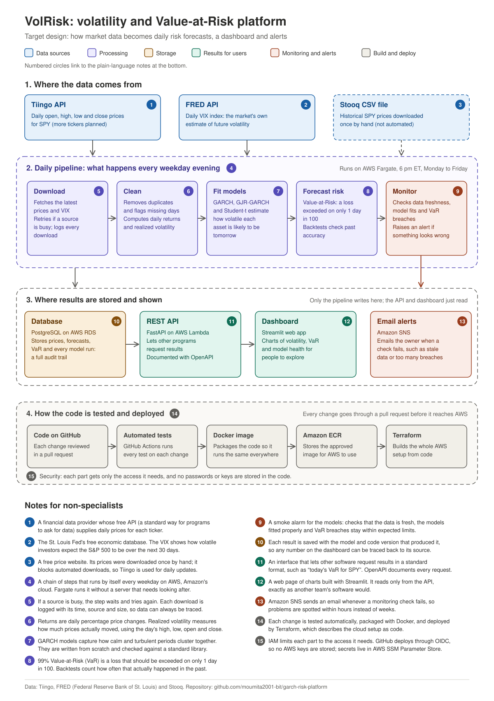

# garch-risk-platform

VolRisk: a volatility and Value-at-Risk platform for SPY. GARCH-family models
are built from scratch in Python, validated against the `arch` package, and
backtested out of sample. One command (`volrisk run`) downloads data, fits the
model and writes tomorrow's VaR. The pipeline is containerized with Docker and
tested on every pull request; AWS deployment for daily automated runs is next
(see [Project status](#project-status)).

## Architecture

## Results so far

**Week 1: Stylized facts of SPY returns (2008–2026)**
- Excess kurtosis 14.2; 37 four-sigma days vs 0.3 expected under normality
- ARCH-LM = 1,301 (p < 0.0001): strong volatility clustering
- [EDA summary](docs/eda_summary.md)

**Week 2: GARCH(1,1) built from scratch**
- Maximum-likelihood estimation with scipy, parameter-recovery tests
- Matches the `arch` package to 4 decimal places (α = 0.149, β = 0.829)
- [Validation report](docs/garch_validation.md)

**Week 3: Student-t innovations**
- BIC favours Student-t over normal by 271 points; ν = 5.5
- [Comparison report](docs/student_t_comparison.md)

**Week 4: 99% VaR, backtested out of sample (3,732 days)**

| Model | Breaches (37 expected) | Kupiec p | Christoffersen p |
|---|---|---|---|
| Normal GARCH | 87 | <0.001 | 0.208 |
| Student-t GARCH | 59 | 0.001 | 0.016 |
| **GJR-GARCH-t, μ = 0** | **48** | **0.092** | **0.155** |

Each change was driven by a diagnostic. On SPY, only down days raise
volatility (γ = 0.27, α = 0). [Backtest report](docs/var_backtest.md)

**Week 5: VIX comparison and a one-command pipeline**
- Model volatility vs VIX: correlation 0.90; VIX sits 3.7 points above
  realized volatility on average (the variance risk premium)
- `volrisk run` downloads, cleans, fits and writes tomorrow's VaR as JSON
- [VIX report](docs/vix_vs_garch.md)

**Week 6: CI and Docker**
- GitHub Actions runs all 92 tests and builds the Docker image on every pull
  request; both checks are required before merging to `main`
- Docker image (python:3.12-slim, non-root, no secrets baked in) reproduces
  the native result exactly: 99% VaR 1.98% on 2026-10-29
- CI exposed an optimizer that could report success at a poor point; `fit()`
  now validates its result and retries, and reports non-convergence otherwise

## Quick start

~~~bash
git clone https://github.com/moumita2001-bit/garch-risk-platform.git
cd garch-risk-platform
python -m venv .venv && source .venv/bin/activate
pip install -e ".[dev,research]"
cp .env.example .env        # add TIINGO_API_KEY and FRED_API_KEY
volrisk run                 # writes results/spy_<date>.json
python -m pytest -q         # 92 tests, no network or API keys needed
~~~

### Run with Docker

~~~bash
docker build -t volrisk .
docker run --rm --env-file .env -v "$PWD/results:/app/results" volrisk
~~~

API keys are passed in at run time and never stored in the image.

## Project layout

~~~text
src/volrisk/
  data/       Tiingo and FRED downloaders, cleaning and validation
  models/     GARCH, Student-t and GJR-GARCH-t, simulator
  risk/       one-day VaR, rolling backtest, Kupiec and Christoffersen tests
  pipeline.py the daily job (download -> clean -> fit -> VaR)
  cli.py      the `volrisk` command
notebooks/    reproducible analysis scripts that generate the reports in docs/
tests/        92 tests, run in CI on every pull request
~~~

## Project status

| Area | Status |
|---|---|
| Data pipeline (Tiingo, FRED) | Done |
| GARCH, Student-t and GJR models built from scratch | Done |
| VaR and out-of-sample backtesting | Done |
| One-command daily pipeline | Done |
| Docker image and CI | Done |
| AWS deployment (Fargate, S3, scheduled runs) | Planned |
| Monitoring and REST API | Planned |

## Build journal

Weekly decisions, results and lessons: [docs/journal.md](docs/journal.md)

## License

MIT