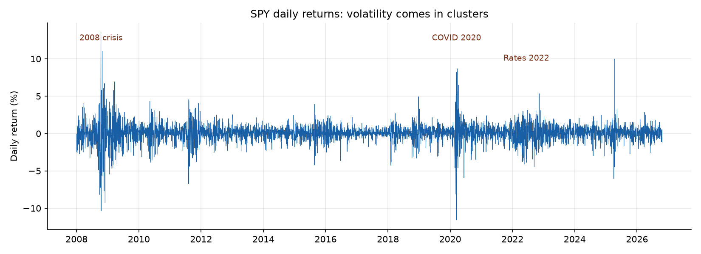
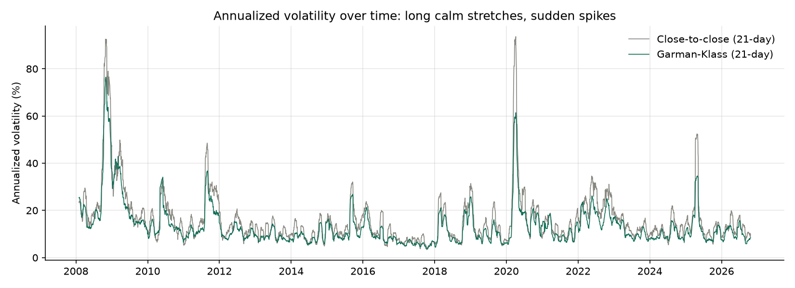
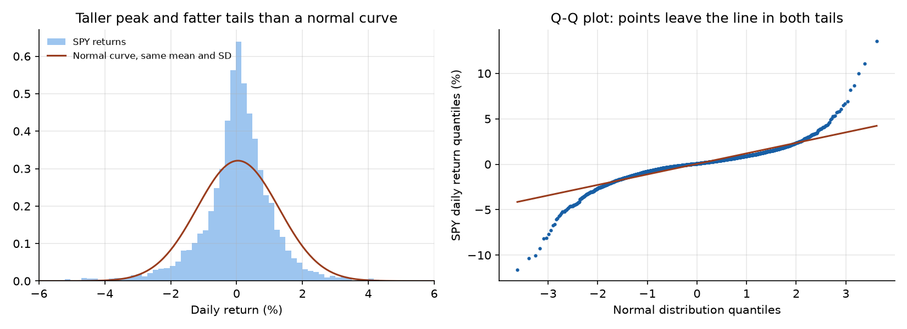
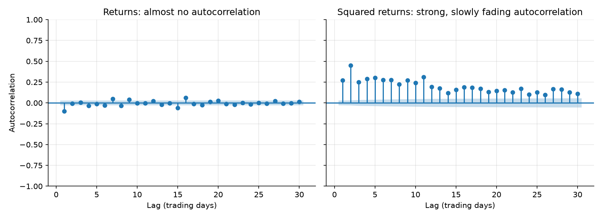

# Week 1 exploration: SPY daily returns

Data: 4,732 trading days from 2008-01-03 to 2026-10-23 (Tiingo, adjusted prices).
Generated by `notebooks/01_eda.py`.

## Summary statistics

| Measure | Value |
| --- | --- |
| Average daily return | 0.042% |
| Daily volatility | 1.24% |
| Annualized volatility | 19.7% |
| Skewness | -0.29 |
| Excess kurtosis (0 for a normal curve) | 14.2 |
| Worst day | -11.59% on 2020-03-16 |
| Best day | 13.56% on 2008-10-13 |

## 1. Volatility clustering

Turbulent days bunch together around 2008, 2020 and 2022, separated by long calm stretches.

## 2. Fat tails

Moves beyond 4 standard deviations happened on **37 days**; a normal
curve predicts about **0.3**. Excess kurtosis of
14.2 supports Student-t errors in the models.

## 3. Volatility is predictable

| Test (10 lags) | Statistic | p-value | Reading |
| --- | --- | --- | --- |
| Ljung-Box on returns | 84.4 | < 0.0001 | Weak: direction of returns is hard to predict |
| Ljung-Box on squared returns | 4022.7 | < 0.0001 | Strong: size of moves is predictable |
| ARCH-LM | 1301.4 | < 0.0001 | Volatility changes over time |

## Conclusion

Squared returns are strongly autocorrelated and the ARCH-LM test rejects constant volatility, so a GARCH model is justified.
