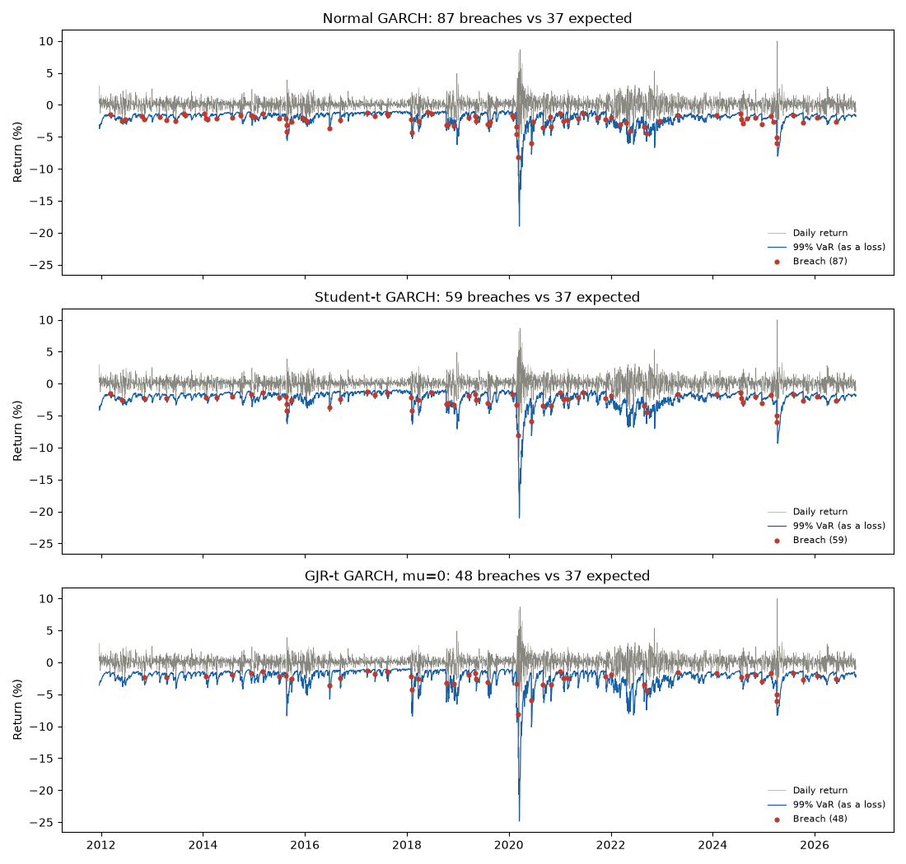

# Week 4: out-of-sample 99% VaR backtest on SPY

Test period: 2011-12-20 to 2026-10-23 (3,732 trading days).
Each day's VaR uses only earlier data: re-fit every 21 days on the
previous 1,000 days. Generated by `notebooks/04_var_backtest.py`.

| Model | Breaches | Expected | Rate | Kupiec p | Christoffersen p | Worst 250-day count | Days in red zone | Zone now |
| --- | --- | --- | --- | --- | --- | --- | --- | --- |
| Normal GARCH | 87 | 37.3 | 2.33% | 0.000 (reject) | 0.208 (pass) | 11 | 6.3% | green |
| Student-t GARCH | 59 | 37.3 | 1.58% | 0.001 (reject) | 0.016 (reject) | 8 | 0.0% | green |
| GJR-t GARCH, mu=0 | 48 | 37.3 | 1.29% | 0.092 (pass) | 0.155 (pass) | 7 | 0.0% | green |

- **Kupiec** tests whether the breach rate is 1%; **Christoffersen** tests
  whether breaches cluster. p < 0.05 rejects the model.
- **Basel zones** (99% VaR, 250 days): green 0-4, yellow 5-9, red 10+.
