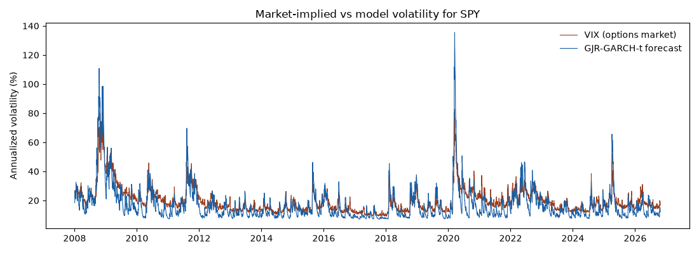

# Week 5: GJR-GARCH-t volatility vs VIX

4,731 days from 2008-01-03 to 2026-10-22.
Model fitted once on the full sample (gamma = 0.274, nu = 6.43).
Generated by `notebooks/05_vix_vs_garch.py`.

| Measure | Value |
| --- | --- |
| Correlation of levels | 0.897 |
| Correlation of daily changes | 0.746 |
| Average VIX | 19.9% |
| Average GARCH forecast | 16.9% |
| Average realized vol, next 21 days | 16.2% |
| Variance risk premium (VIX minus realized), average | +3.7 points |
| Share of days VIX was above realized | 84% |
| Mean absolute error vs realized: VIX | 6.4 points |
| Mean absolute error vs realized: GARCH | 5.5 points |

- VIX and the model share the same crises, so the level correlation is high.
- VIX usually sits above the volatility that follows: investors pay extra
  for protection against crashes (the variance risk premium).
- Note: this comparison uses a full-sample fit, so it is descriptive,
  not an out-of-sample forecast test.
